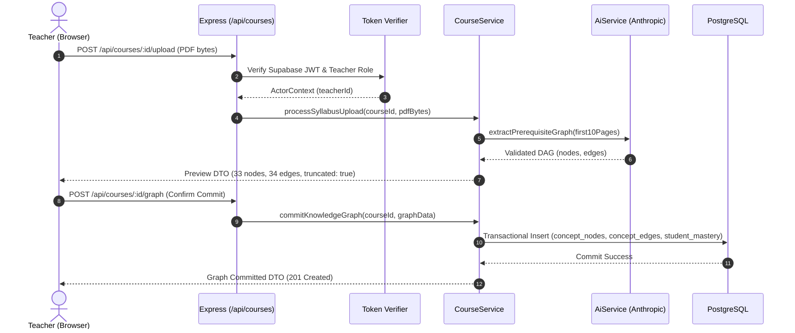
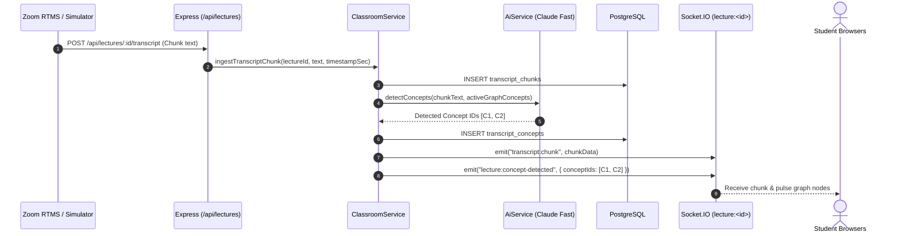
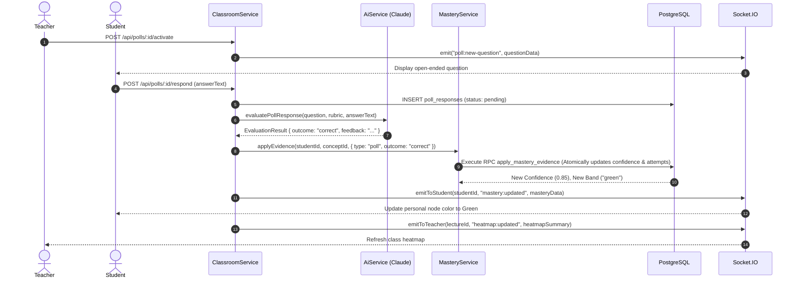
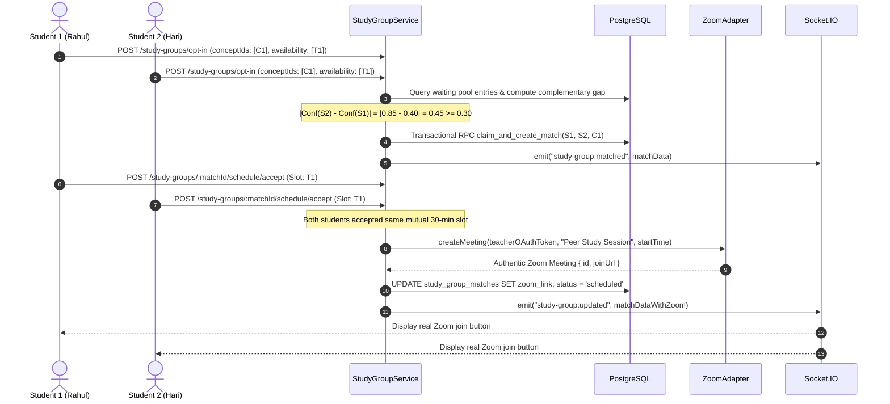

# System Architecture: Single-Process TypeScript Monolith

## 1. Runtime Design & Server Composition

HackOHIO Classroom Companion is designed as a unified, single-process TypeScript application hosted on Node.js 24 LTS. It replaces the split Python (Flask) and Node.js (Next.js) architecture of the sibling prototype with a cohesive, contract-driven modular monolith.

```text
┌────────────────────────────────────────────────────────────────────────┐
│                        Node.js 24 LTS Process                          │
│                                                                        │
│   ┌────────────────────────────────────────────────────────────────┐   │
│   │                 server/index.ts (Composition Root)             │   │
│   │   - Initializes config, Supabase clients, and PostgreSQL pools  │   │
│   │   - Constructs Core, Classroom, Learning, and AI services      │   │
│   │   - Mounts Express 5 REST router on /api/*                     │   │
│   │   - Attaches Socket.IO 4 server with JWT handshake auth         │   │
│   │   - Delegates all remaining page routes to Next.js 16 handler  │   │
│   └───────────────────────────────┬────────────────────────────────┘   │
│                                   │                                    │
│         ┌─────────────────────────┴────────────────────────┐           │
│         ▼                                                  ▼           │
│  ┌──────────────┐                                   ┌──────────────┐   │
│  │  Express 5   │                                   │ Socket.IO 4  │   │
│  │  HTTP API    │                                   │ Real-time    │   │
│  │  (/api/*)    │                                   │ WSS Engine   │   │
│  └──────┬───────┘                                   └──────┬───────┘   │
│         │                                                  │           │
│         └─────────────────────────┬────────────────────────┘           │
│                                   ▼                                    │
│  ┌──────────────────────────────────────────────────────────────────┐  │
│  │                    Domain Service Modules                        │  │
│  │  - CourseService     - ClassroomService    - StudyGroupService   │  │
│  │  - GraphService      - MasteryService      - LearningService     │  │
│  │  - AiService         - ZoomAdapter         - RealtimePublisher   │  │
│  └────────────────────────────────┬─────────────────────────────────┘  │
│                                   │                                    │
│         ┌─────────────────────────┴────────────────────────┐           │
│         ▼                                                  ▼           │
│  ┌──────────────┐                                   ┌──────────────┐   │
│  │  Supabase    │                                   │  Third-Party │   │
│  │  PostgreSQL  │                                   │  Adapters    │   │
│  │  (22 Tables  │                                   │  (Anthropic, │   │
│  │  + RPCs)     │                                   │  Perplexity, │   │
│  └──────────────┘                                   │  Zoom RTMS)  │   │
│                                                     └──────────────┘   │
│                                                                        │
│  ┌──────────────────────────────────────────────────────────────────┐  │
│  │             Next.js 16 App Router (React 19 SSR & UI)            │  │
│  │  - Thin route shells (/app/*)                                    │  │
│  │  - Feature views (src/features/*)                                │  │
│  │  - Shared UI components (src/components/ui/*)                    │  │
│  │  - Typed browser client (src/lib/client/*)                       │  │
│  └──────────────────────────────────────────────────────────────────┘  │
└────────────────────────────────────────────────────────────────────────┘
```

### Custom Server Tradeoffs & Justification
As documented in [ADR 0002](adr/0002-persistent-next-express-socketio.md), the application runs via a custom server (`server/index.ts`).
- **Official Guidance**: Next.js documents custom server constraints at <https://github.com/vercel/next.js/blob/v16.1.6/docs/01-app/02-guides/custom-server.mdx>, noting that custom servers bypass certain serverless optimizations (such as automatic edge slicing and Vercel-specific serverless routing).
- **Architectural Rationale**: Classroom Companion requires persistent in-memory WebSocket connections, stateful lecture presence tracking, and long-lived Zoom RTMS socket streams. A persistent single-process server allows Express, Socket.IO, and Next.js to share direct in-memory service instances and event emitters without requiring an external Redis broker for single-node deployments.

---

## 2. Directory Layout & Module Boundaries

The repository enforces strict module encapsulation:

```text
server/
  index.ts                      # Composition root: HTTP + Socket.IO + Next.js mounting
src/
  contracts/                    # Frozen public Zod schemas, DTOs, and event types
  server/
    platform/                   # Database client, token verification, logging, errors
    core/                       # Course lifecycle, enrollment, graph, mastery, and game progression (GameService)
    classroom/                  # Lecture lifecycle, transcript, poll, and summary logic
    realtime/                   # Authenticated WebSocket rooms, presence, and publishing
    zoom/                       # Zoom OAuth 2.0, webhook HMAC, and RTMS client
    study-groups/               # Opt-in pool, matchmaking, availability, peer chat
    ai/                         # Anthropic Claude and Perplexity pipeline adapters
    learning/                   # Socratic tutoring, learning pages, quizzes, encounters (EncounterService)
  features/
    auth/                       # Sign-in, sign-up, session restoration UI
    courses/                    # Course creation, syllabus upload, enrollment UI
    professor/                  # Teacher live lecture dashboard, heatmap, poll controls
    student/                    # Student lecture view, live transcript, poll response UI
    graph/                      # Interactive D3-force knowledge graph component
    tutor/                      # Socratic tutoring chat interface (Lane C export)
    learning/                   # Learning pages, practice quizzes, cited resources (Lane C)
    study-groups/               # Study pool opt-in, peer chat, scheduling UI (Lane C)
    encounters/                 # Practice encounter modal, tiered hints, Spark reactions (Lane C export)
  components/
    ui/                         # Shared design primitives (Button, Modal, Card, Badge)
  lib/
    client/                     # Typed browser HTTP client and Socket.IO connection manager
  app/                          # Next.js App Router route shells (Lane D ownership)
supabase/
  migrations/                   # Ordered SQL migrations and PostgreSQL RPC functions
scripts/                        # TypeScript bootstrap, seed, preflight, and demo scripts
tests/
  unit/                         # Isolated Vitest unit tests (partitioned by lane)
  contracts/                    # Schema and boundary validation tests
  integration/                  # Supabase PostgreSQL and local integration tests
  e2e/                          # Playwright multi-browser end-to-end journey tests
```

---

## 3. Technology Stack & Rationale

| Layer | Selected Technology | Selection Rationale |
|---|---|---|
| **Runtime** | Node.js 24 LTS | Long-term support, stable native WebSockets, modern ES module support. |
| **Language** | TypeScript 5.8 (Strict) | End-to-end type safety, eliminating serialization drift between backend and frontend. |
| **HTTP Framework** | Express 5 | Robust, mature routing for all `/api/*` endpoints with full middleware composition. |
| **Real-Time Engine** | Socket.IO 4 | WebSocket transport with fallback, room multiplexing, and client reconnection protocols. |
| **Frontend Framework** | Next.js 16 (App Router) | React 19 Server Components for layout shells; client components for interactive UI. |
| **Database & Auth** | Supabase (PostgreSQL 15) | Relational integrity, transactional RPC functions, and secure authentication engine. |
| **Schema Validation** | Zod 4 | Runtime type inference, request validation, and AI structured output parsing. |
| **Graph Visualizer** | D3-force | Physics-based force-directed layout with deterministic hierarchical prerequisite constraints. |
| **Animation Engine** | `motion/react` | Modern, smooth React UI transitions without legacy `framer-motion` baggage. |
| **AI LLM Provider** | Anthropic Claude 3.5 / 3.7 | Industry-leading reasoning for syllabus graph extraction, rubric grading, and Socratic tutoring. |
| **Search Provider** | Perplexity AI | Real-time academic web search with citation validation. |
| **Meeting Platform** | Zoom REST & RTMS APIs | Authentic lecture transcript streaming and peer study session creation via OAuth 2.0. |

---

## 4. End-to-End Sequence Workflows

### 4.1 Syllabus Upload & Prerequisite Graph Generation


### 4.2 Live Lecture Transcript Ingestion & Concept Detection


### 4.3 Formative Poll Execution & Atomic Mastery Update


### 4.4 Consensual Peer Match & Authentic Zoom Scheduling


### 4.5 Practice Encounter with Tiered Hints & XP Progression
```mermaid
sequenceDiagram
    autonumber
    actor Student as Student (Rahul)
    participant Express as Express (/api/encounters)
    participant Encounters as EncounterService
    participant Game as GameService
    participant Mastery as MasteryService
    participant DB as PostgreSQL (xp_events, quiz_attempts, daily_quests)
    participant Sockets as Socket.IO (student:<id>)

    Student->>Express: POST /api/students/:id/encounters { conceptId, source: "daily", questId }
    Express->>Encounters: createEncounter(actor, studentId, input)
    Encounters->>DB: INSERT encounters (status: 'active', questions: 5)
    Encounters-->>Student: EncounterDTO (5 questions, options permuted, 0 hints used)

    Student->>Express: POST /api/encounters/:id/hints { questionId: Q1, level: 1 }
    Express->>Encounters: getHint(actor, encounterId, Q1, level: 1)
    Encounters->>DB: Verify level sequence (level 1 after 0); UPDATE encounters released hints
    Encounters-->>Student: { questionId: Q1, level: 1, text: "Consider the chain rule..." }

    Student->>Express: POST /api/encounters/:id/submit { answers: [{ questionId, selectedOption }, ...] }
    Express->>Encounters: submitEncounter(actor, encounterId, answers)
    Encounters->>DB: Grade answers against stored keys; calculate score (4/5 = 80%)
    Encounters->>Mastery: applyEvidence(studentId, conceptId, { type: "quiz", score: 0.80 })
    Mastery->>DB: Execute apply_mastery_evidence (+0.15 delta -> confidence 0.35)
    Encounters->>Game: recordPracticeReward(studentId, conceptId, answersWithHints)
    Game->>DB: INSERT xp_events (UNIQUE key per student/concept/date; e.g., +88 XP)
    Game->>DB: UPDATE daily_quests (mark concept completed; check if all clear)
    Note over Game,DB: If all items completed, set cleared_at, award +25 XP, increment streak
    Encounters->>Sockets: emitToStudent(studentId, "game:updated", { summary, dailyQuest })
    Encounters-->>Student: EncounterResultDTO { score, confidence, band, xpAwarded, summary, dailyQuest }
```
