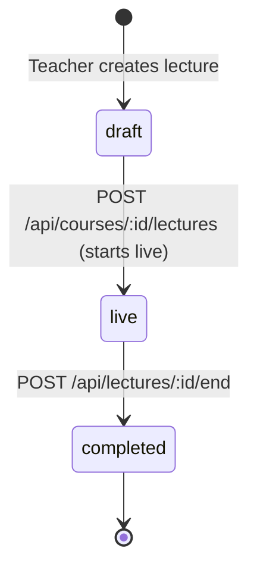
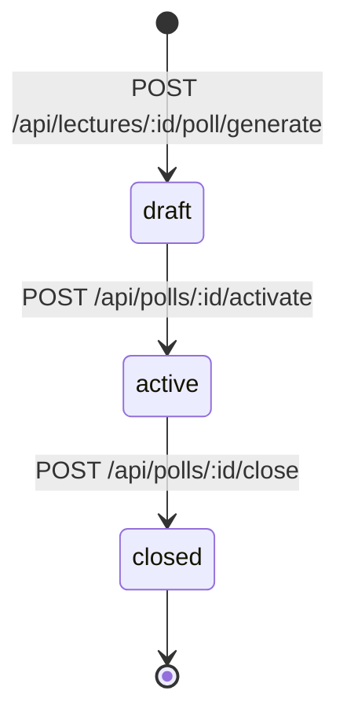

# Formal System Invariants & Mathematical Rules

This document specifies the authoritative mathematical formulas, state machine invariants, domain constraints, and failure counterexamples governing HackOHIO Classroom Companion. All services, database triggers, RPCs, and UI components MUST adhere strictly to these rules.

---

## 1. Mastery Calculation & Confidence Invariants

### 1.1 Confidence Representation
- **Domain Invariant (INV-M01)**: Confidence $c$ is a real scalar strictly confined to the closed interval $[0.0, 1.0]$.
  $$\forall c \in \text{Confidence}, \quad 0.0 \le c \le 1.0, \quad c \in \mathbb{R}_{\text{finite}}$$
  $c = \text{NaN}$, $c = \pm\infty$, or values outside $[0.0, 1.0]$ are strictly illegal and MUST be rejected with a validation error before database operations.

### 1.2 Canonical Mastery Bands
- **Domain Invariant (INV-M02)**: Confidence maps deterministically to exactly one of four canonical semantic mastery bands via the pure function `confidenceToBand(c)`:
  $$\text{confidenceToBand}(c) = \begin{cases} 
  \text{gray} & \text{if } c = 0.0 \\
  \text{red} & \text{if } 0.0 < c < 0.40 \\
  \text{yellow} & \text{if } 0.40 \le c < 0.70 \\
  \text{green} & \text{if } c \ge 0.70 
  \end{cases}$$
- *Historical Note*: Prototype cosmetic sub-tiers (`orange` and `lime`) are consolidated: `orange` ($0 < c < 0.40$) maps to `red`; `lime` ($0.55 \le c < 0.70$) maps to `yellow`.

### 1.3 Evidence-Driven Mutation Formulas
Confidence is mutated exclusively through the pure function `applyMasteryEvidence(current, evidence)`. Direct confidence assignment by client request is forbidden.

#### Evidence Type 1: Formative Poll Response (`poll`)
Evaluated by AI into three discrete outcomes:
$$\text{poll}(c_{\text{old}}, \text{outcome}) = \begin{cases}
\max(c_{\text{old}}, 0.85) & \text{if outcome} = \text{correct} \\
\max(c_{\text{old}}, 0.50) & \text{if outcome} = \text{partial} \\
0.20 & \text{if outcome} = \text{wrong} \land c_{\text{old}} = 0.0 \\
\min(c_{\text{old}}, 0.20) & \text{if outcome} = \text{wrong} \land c_{\text{old}} > 0.0
\end{cases}$$
- *Invariant*: A `correct` outcome guarantees a `green` band ($c \ge 0.85$). A `wrong` outcome forces a `red` band ($c \le 0.20$).

#### Evidence Type 2: Socratic Tutoring Breakthrough (`tutor`)
Awarded when a multi-turn dialogue demonstrates concept understanding:
$$\text{tutor}(c_{\text{old}}) = \min(c_{\text{old}} + 0.20, 1.0)$$
- *Invariant*: Tutoring never decreases confidence and is clamped at $1.0$.

#### Evidence Type 3: Server-Evaluated Practice Quiz (`quiz`)
Calculated from the fraction of correct answers $s = \frac{\text{correctCount}}{\text{totalQuestions}}$ (where $\text{totalQuestions} = 5$):
$$\text{quiz}(c_{\text{old}}, s) = \min\left(c_{\text{old}} + \Delta(s), 1.0\right) \quad \text{where} \quad \Delta(s) = \begin{cases}
+0.15 & \text{if } s \ge 0.80 \\
+0.10 & \text{if } 0.60 \le s < 0.80 \\
+0.05 & \text{if } 0.40 \le s < 0.60 \\
+0.02 & \text{if } s < 0.40
\end{cases}$$
- *Invariant*: Server evaluates score $s$ from stored answer keys. Client-submitted score deltas are strictly rejected.

#### Evidence Type 4: Lecture Attendance & Exposure (`attendance`)
Awarded during active lecture concept discussion:
$$\text{attendance}(c_{\text{old}}) = \begin{cases}
\min(c_{\text{old}} + 0.05, 0.30) & \text{if } c_{\text{old}} < 0.30 \\
c_{\text{old}} & \text{if } c_{\text{old}} \ge 0.30
\end{cases}$$
- *Invariant*: Passive lecture attendance can never advance a student out of the `red` band ($c \le 0.30 < 0.40$).

### 1.4 Attempt Counter Invariant
- **Domain Invariant (INV-M03)**: The `student_mastery.attempts` counter MUST count evaluated poll responses only. Attendance boosts, tutoring breakthroughs, and practice quizzes MUST NOT increment `student_mastery.attempts`. Practice quiz attempts are tracked independently in `quiz_attempts`.

---

## 2. Knowledge Graph & Prerequisite Invariants

### 2.1 Prerequisite Directionality
- **Domain Invariant (INV-G01)**: All edges in `concept_edges` are strictly directed from prerequisite to dependent:
  $$\text{Edge}(u, v) \implies u \text{ is a prerequisite for } v \quad (\text{must learn } u \text{ before } v)$$
- *Database Invariant*: `source_id = u` (prerequisite), `target_id = v` (dependent).

### 2.2 Graph Acyclicity & Topology
- **Domain Invariant (INV-G02)**: The knowledge graph for any course MUST be a Directed Acyclic Graph (DAG).
  $$\forall v \in V, \quad v \notin \text{Reachable}^{+}(v)$$
- **Zero Self-Edges (INV-G03)**: $\forall e = (u, v) \in E, \quad u \ne v$.
- **Disjoint Components Permitted (INV-G04)**: The graph is not required to be weakly or strongly connected. Valid disconnected clusters (e.g., probability vs. linear algebra) are permitted.
- **Node Bounds (INV-G05)**: Committed graphs MUST contain between 1 and 40 nodes ($1 \le |V| \le 40$).

### 2.3 Incoming-Prerequisite Weighting Formula
- **Domain Invariant (INV-G06)**: Node importance measures incoming-prerequisite depth, calculated via the exact formula:
  $$\text{in\_degree}(v) = |\{u \in V \mid (u, v) \in E\}|$$
  $$\text{max\_in} = \max_{u \in V} \text{in\_degree}(u)$$
  $$\text{score}(v) = \begin{cases} \frac{\text{in\_degree}(v)}{\text{max\_in}} & \text{if } \text{max\_in} > 0 \\ 0.5 & \text{if } \text{max\_in} = 0 \end{cases}$$
  $$\text{importance}(v) = \frac{1}{1 + e^{-(\text{round}(\text{score}(v), 3) + 1)}}$$
- *Definition*: Higher importance reflects a higher number of direct prerequisites required to understand node $v$.

### 2.4 Ancestor Traversal
- **Domain Invariant (INV-G07)**: Ancestor traversal for concept $v$ traverses incoming edges backward (`target_id = v` $\to$ `source_id = u`) and terminates via a visited set. Because the graph is guaranteed acyclic (INV-G02), traversal is guaranteed to terminate in $O(|V| + |E|)$ operations.

---

## 3. Syllabus Ingestion Invariants

### 3.1 Bounded PDF Extraction
- **Domain Invariant (INV-S01)**: Syllabus PDF extraction processes at most 10 pages:
  $$\text{processedPages} = \min(\text{totalPages}, 10)$$
- **Disclosure Invariant (INV-S02)**: When $\text{totalPages} > 10$, the extraction preview response MUST set `truncated: true` and surface a visual notification to the teacher.

### 3.2 Two-Phase Commit & Immutability
- **Domain Invariant (INV-S03)**: Syllabus upload (`POST /upload`) produces an ephemeral preview. Persistent database insertion requires explicit confirmation (`POST /graph`).
- **Graph Conflict Invariant (INV-S04)**: If a course already has committed concept nodes ($|V| > 0$), any subsequent attempt to commit a graph MUST return `409 GRAPH_ALREADY_EXISTS`. Graph replacement in this release requires creating a new course.

---

## 4. Lecture & Formative Poll State Machines

### 4.1 Lecture Lifecycle

- **Invariant (INV-L01)**: Only a lecture in `live` status can ingest transcript chunks, broadcast real-time events, or accept poll responses.

### 4.2 Formative Poll State Transitions

- **Single Active Poll Invariant (INV-P01)**: Within any single lecture, at most ONE poll may have status `active` at any given time. Activating a poll while another is active MUST return `409 ACTIVE_POLL_EXISTS`.
- **Response Invariant (INV-P02)**: Responses are accepted ONLY when the poll status is `active`. Submissions to `draft` or `closed` polls MUST be rejected with `400 INVALID_POLL_STATUS`.
- **Single Student Submission (INV-P03)**: A student may submit at most one response per poll. Subsequent identical submissions return the existing evaluated response; conflicting submissions return `409 RESPONSE_ALREADY_SUBMITTED`.

---

## 5. Consensual Peer Collaboration Invariants

### 5.1 Study Pool Ephemeral Lifespan
- **Domain Invariant (INV-C01)**: An opt-in pool entry is valid for exactly 5 minutes from creation:
  $$\text{isValid}(t) \iff t \le \text{created\_at} + 5 \text{ minutes} \land \text{status} = \text{'waiting'}$$
  Expired pool entries MUST be cleaned up and cannot be matched.

### 5.2 Complementary Knowledge Gap Score
- **Domain Invariant (INV-C02)**: Two students $S_1$ and $S_2$ in the pool for course $C$ are eligible to match if and only if they share at least one requested concept and exhibit a complementary knowledge gap $\ge 0.30$:
  $$K = \text{concepts}(S_1) \cap \text{concepts}(S_2) \ne \emptyset$$
  $$\text{gap}(S_1, S_2) = \frac{1}{|K|} \sum_{c \in K} |c_{S_1}(c) - c_{S_2}(c)| \ge 0.30$$
- *Invariant*: If $\text{gap}(S_1, S_2) < 0.30$, the pairing is rejected. Peers who have identical confidence levels cannot be matched.

### 5.3 Match Pairing Order & Canonical Ordering
- **Database Invariant (INV-C03)**: To eliminate duplicate match records, `study_group_matches` enforces a strict UUID ordering constraint:
  $$\text{CHECK} (\text{student1\_id} < \text{student2\_id})$$
- **Atomic Pair Claiming (INV-C04)**: Matching claims both pool entries within a single database transaction with row-level locks (`FOR UPDATE`), transitioning both pool rows to `matched`.

### 5.4 Scheduling & Bilateral Consent
- **Domain Invariant (INV-C05)**: Peer meetings require bilateral acceptance of the same mutual availability interval:
  $$\text{meetingCreated} \iff \text{accepted}(S_1, I) \land \text{accepted}(S_2, I) \quad \text{where } I = [t_{\text{start}}, t_{\text{end}}) \land (t_{\text{end}} - t_{\text{start}} \ge 30 \text{ min})$$
- *Invariant*: If no overlapping interval exists, match status is `no-overlap`. Authentic Zoom meetings are generated ONLY upon bilateral acceptance.

---

## 6. Failure Counterexamples & Boundary Cases

| Scenario | Incorrect / Naive Behavior (Prohibited) | Correct Behavior (Enforced) |
|---|---|---|
| **Invalid JWT in Request** | Fall back to unverified payload decode or trust client header. | Return `401 UNAUTHORIZED`; terminate request immediately. |
| **Student Requests Teacher Room** | Allow socket join if client provides `role: "teacher"`. | Server validates authenticated token role; rejects socket room join with `403 FORBIDDEN`. |
| **Duplicate Poll Response** | Overwrite existing response and increment attempts counter again. | Return existing evaluation or `409 RESPONSE_ALREADY_SUBMITTED`; attempts incremented exactly once. |
| **AI Evaluation Timeout** | Fabricate a default "partial" score ($c=0.50$) to avoid UI errors. | Leave response in `pending_evaluation` status; confidence unchanged; notify student/teacher of error. |
| **Client Submits Quiz Score** | Accept client-supplied `correctCount: 5` and apply $+0.15$ delta. | Reject request. Server grades answers against stored `concept_quiz_questions` keys. |
| **Single Peer Opts In** | Match with a random student from the course roster. | Keep student in pool with status `waiting`. Match only if another student opts in with gap $\ge 0.30$. |
| **Missing Zoom Credentials** | Generate a fake link like `https://zoom.us/j/fake123`. | Keep match active for messaging; set `meetingStatus = "unavailable"`; surface honest configuration notice. |
| **Socket Disconnect on Multi-Tab** | Terminate lecture attendance when student closes one tab. | Reference count active connections per student; terminate attendance only when ref count drops to zero. |
