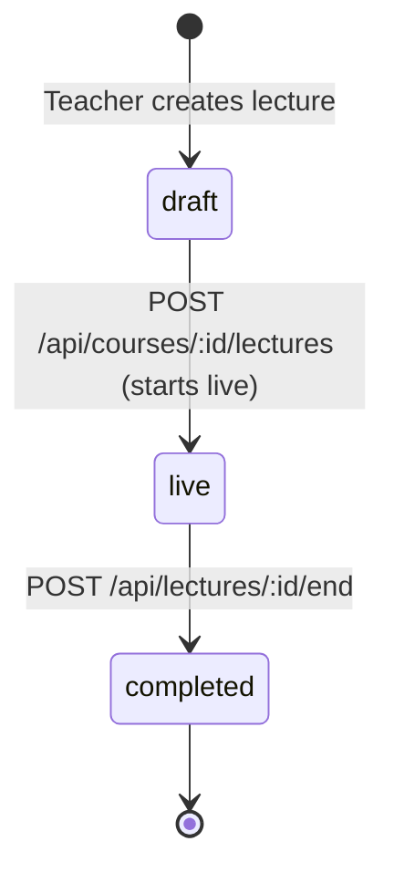
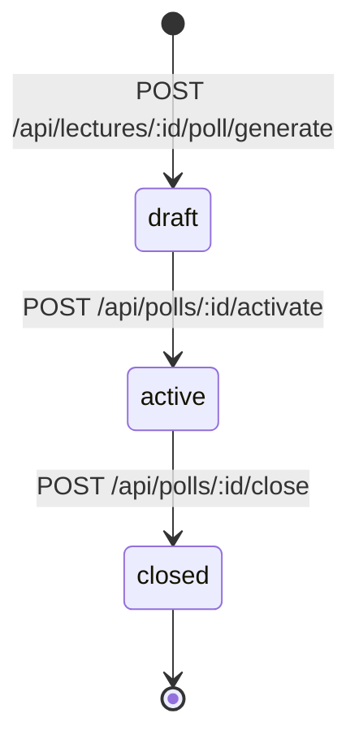

# Formal System Invariants & Mathematical Rules

This document specifies the authoritative mathematical formulas, state machine invariants, domain constraints, and failure counterexamples governing HackOHIO Classroom Companion. All services, database triggers, RPCs, and UI components MUST adhere strictly to these rules.

---

## 1. Mastery Calculation & Confidence Invariants

### 1.1 Confidence Representation
- **Domain Invariant (INV-M01)**: Confidence $c$ is a real scalar strictly confined to the closed interval $[0.0, 1.0]$.
  $$\forall c \in \text{Confidence}, \quad 0.0 \le c \le 1.0, \quad c \in \mathbb{R}_{\text{finite}}$$
  $c = \text{NaN}$, $c = \pm\infty$, or values outside $[0.0, 1.0]$ are strictly illegal and MUST be rejected with a validation error before database operations.

### 1.2 Canonical Mastery Bands
- **Domain Invariant (INV-M02)**: Confidence maps deterministically to exactly one of four canonical semantic mastery bands via the pure function `confidenceToBand(c)`:
  $$\text{confidenceToBand}(c) = \begin{cases} 
  \text{gray} & \text{if } c = 0.0 \\
  \text{red} & \text{if } 0.0 < c < 0.40 \\
  \text{yellow} & \text{if } 0.40 \le c < 0.70 \\
  \text{green} & \text{if } c \ge 0.70 
  \end{cases}$$
- *Historical Note*: Prototype cosmetic sub-tiers (`orange` and `lime`) are consolidated: `orange` ($0 < c < 0.40$) maps to `red`; `lime` ($0.55 \le c < 0.70$) maps to `yellow`.

### 1.3 Evidence-Driven Mutation Formulas
Confidence is mutated exclusively through the pure function `applyMasteryEvidence(current, evidence)`. Direct confidence assignment by client request is forbidden.

#### Evidence Type 1: Formative Poll Response (`poll`)
Evaluated by AI into three discrete outcomes:
$$\text{poll}(c_{\text{old}}, \text{outcome}) = \begin{cases}
\max(c_{\text{old}}, 0.85) & \text{if outcome} = \text{correct} \\
\max(c_{\text{old}}, 0.50) & \text{if outcome} = \text{partial} \\
0.20 & \text{if outcome} = \text{wrong} \land c_{\text{old}} = 0.0 \\
\min(c_{\text{old}}, 0.20) & \text{if outcome} = \text{wrong} \land c_{\text{old}} > 0.0
\end{cases}$$
- *Invariant*: A `correct` outcome guarantees a `green` band ($c \ge 0.85$). A `wrong` outcome forces a `red` band ($c \le 0.20$).

#### Evidence Type 2: Socratic Tutoring Breakthrough (`tutor`)
Awarded when a multi-turn dialogue demonstrates concept understanding:
$$\text{tutor}(c_{\text{old}}) = \min(c_{\text{old}} + 0.20, 1.0)$$
- *Invariant*: Tutoring never decreases confidence and is clamped at $1.0$.

#### Evidence Type 3: Server-Evaluated Practice Quiz (`quiz`)
Calculated from the fraction of correct answers $s = \frac{\text{correctCount}}{\text{totalQuestions}}$ (where $\text{totalQuestions} = 5$):
$$\text{quiz}(c_{\text{old}}, s) = \min\left(c_{\text{old}} + \Delta(s), 1.0\right) \quad \text{where} \quad \Delta(s) = \begin{cases}
+0.15 & \text{if } s \ge 0.80 \\
+0.10 & \text{if } 0.60 \le s < 0.80 \\
+0.05 & \text{if } 0.40 \le s < 0.60 \\
+0.02 & \text{if } s < 0.40
\end{cases}$$
- *Invariant*: Server evaluates score $s$ from stored answer keys. Client-submitted score deltas are strictly rejected.

#### Evidence Type 4: Lecture Attendance & Exposure (`attendance`)
Awarded during active lecture concept discussion:
$$\text{attendance}(c_{\text{old}}) = \begin{cases}
\min(c_{\text{old}} + 0.05, 0.30) & \text{if } c_{\text{old}} < 0.30 \\
c_{\text{old}} & \text{if } c_{\text{old}} \ge 0.30
\end{cases}$$
- *Invariant*: Passive lecture attendance can never advance a student out of the `red` band ($c \le 0.30 < 0.40$).

### 1.4 Attempt Counter Invariant
- **Domain Invariant (INV-M03)**: The `student_mastery.attempts` counter MUST count evaluated poll responses only. Attendance boosts, tutoring breakthroughs, and practice quizzes MUST NOT increment `student_mastery.attempts`. Practice quiz attempts are tracked independently in `quiz_attempts`.

---

## 2. Knowledge Graph & Prerequisite Invariants

### 2.1 Prerequisite Directionality
- **Domain Invariant (INV-G01)**: All edges in `concept_edges` are strictly directed from prerequisite to dependent:
  $$\text{Edge}(u, v) \implies u \text{ is a prerequisite for } v \quad (\text{must learn } u \text{ before } v)$$
- *Database Invariant*: `source_id = u` (prerequisite), `target_id = v` (dependent).

### 2.2 Graph Acyclicity & Topology
- **Domain Invariant (INV-G02)**: The knowledge graph for any course MUST be a Directed Acyclic Graph (DAG).
  $$\forall v \in V, \quad v \notin \text{Reachable}^{+}(v)$$
- **Zero Self-Edges (INV-G03)**: $\forall e = (u, v) \in E, \quad u \ne v$.
- **Disjoint Components Permitted (INV-G04)**: The graph is not required to be weakly or strongly connected. Valid disconnected clusters (e.g., probability vs. linear algebra) are permitted.
- **Node Bounds (INV-G05)**: Committed graphs MUST contain between 1 and 40 nodes ($1 \le |V| \le 40$).

### 2.3 Incoming-Prerequisite Weighting Formula
- **Domain Invariant (INV-G06)**: Node importance measures incoming-prerequisite depth, calculated via the exact formula:
  $$\text{in\_degree}(v) = |\{u \in V \mid (u, v) \in E\}|$$
  $$\text{max\_in} = \max_{u \in V} \text{in\_degree}(u)$$
  $$\text{score}(v) = \begin{cases} \frac{\text{in\_degree}(v)}{\text{max\_in}} & \text{if } \text{max\_in} > 0 \\ 0.5 & \text{if } \text{max\_in} = 0 \end{cases}$$
  $$\text{importance}(v) = \frac{1}{1 + e^{-(\text{round}(\text{score}(v), 3) + 1)}}$$
- *Definition*: Higher importance reflects a higher number of direct prerequisites required to understand node $v$.

### 2.4 Ancestor Traversal
- **Domain Invariant (INV-G07)**: Ancestor traversal for concept $v$ traverses incoming edges backward (`target_id = v` $\to$ `source_id = u`) and terminates via a visited set. Because the graph is guaranteed acyclic (INV-G02), traversal is guaranteed to terminate in $O(|V| + |E|)$ operations.

---

## 3. Syllabus Ingestion Invariants

### 3.1 Bounded PDF Extraction
- **Domain Invariant (INV-S01)**: Syllabus PDF extraction processes at most 10 pages:
  $$\text{processedPages} = \min(\text{totalPages}, 10)$$
- **Disclosure Invariant (INV-S02)**: When $\text{totalPages} > 10$, the extraction preview response MUST set `truncated: true` and surface a visual notification to the teacher.

### 3.2 Two-Phase Commit & Immutability
- **Domain Invariant (INV-S03)**: Syllabus upload (`POST /upload`) produces an ephemeral preview. Persistent database insertion requires explicit confirmation (`POST /graph`).
- **Graph Conflict Invariant (INV-S04)**: If a course already has committed concept nodes ($|V| > 0$), any subsequent attempt to commit a graph MUST return `409 GRAPH_ALREADY_EXISTS`. Graph replacement in this release requires creating a new course.

---

## 4. Lecture & Formative Poll State Machines

### 4.1 Lecture Lifecycle

- **Invariant (INV-L01)**: Only a lecture in `live` status can ingest transcript chunks, broadcast real-time events, or accept poll responses.

### 4.2 Formative Poll State Transitions

- **Single Active Poll Invariant (INV-P01)**: Within any single lecture, at most ONE poll may have status `active` at any given time. Activating a poll while another is active MUST return `409 ACTIVE_POLL_EXISTS`.
- **Response Invariant (INV-P02)**: Responses are accepted ONLY when the poll status is `active`. Submissions to `draft` or `closed` polls MUST be rejected with `400 INVALID_POLL_STATUS`.
- **Single Student Submission (INV-P03)**: A student may submit at most one response per poll. Subsequent identical submissions return the existing evaluated response; conflicting submissions return `409 RESPONSE_ALREADY_SUBMITTED`.

---

## 5. Consensual Peer Collaboration Invariants

### 5.1 Study Pool Ephemeral Lifespan
- **Domain Invariant (INV-C01)**: An opt-in pool entry is valid for exactly 5 minutes from creation:
  $$\text{isValid}(t) \iff t \le \text{created\_at} + 5 \text{ minutes} \land \text{status} = \text{'waiting'}$$
  Expired pool entries MUST be cleaned up and cannot be matched.

### 5.2 Complementary Knowledge Gap Score
- **Domain Invariant (INV-C02)**: Two students $S_1$ and $S_2$ in the pool for course $C$ are eligible to match if and only if they share at least one requested concept and exhibit a complementary knowledge gap $\ge 0.30$:
  $$K = \text{concepts}(S_1) \cap \text{concepts}(S_2) \ne \emptyset$$
  $$\text{gap}(S_1, S_2) = \frac{1}{|K|} \sum_{c \in K} |c_{S_1}(c) - c_{S_2}(c)| \ge 0.30$$
- *Invariant*: If $\text{gap}(S_1, S_2) < 0.30$, the pairing is rejected. Peers who have identical confidence levels cannot be matched.

### 5.3 Match Pairing Order & Canonical Ordering
- **Database Invariant (INV-C03)**: To eliminate duplicate match records, `study_group_matches` enforces a strict UUID ordering constraint:
  $$\text{CHECK} (\text{student1\_id} < \text{student2\_id})$$
- **Atomic Pair Claiming (INV-C04)**: Matching claims both pool entries within a single database transaction with row-level locks (`FOR UPDATE`), transitioning both pool rows to `matched`.

### 5.4 Scheduling & Bilateral Consent
- **Domain Invariant (INV-C05)**: Peer meetings require bilateral acceptance of the same mutual availability interval:
  $$\text{meetingCreated} \iff \text{accepted}(S_1, I) \land \text{accepted}(S_2, I) \quad \text{where } I = [t_{\text{start}}, t_{\text{end}}) \land (t_{\text{end}} - t_{\text{start}} \ge 30 \text{ min})$$
- *Invariant*: If no overlapping interval exists, match status is `no-overlap`. Authentic Zoom meetings are generated ONLY upon bilateral acceptance.

---

## 6. Failure Counterexamples & Boundary Cases

| Scenario | Incorrect / Naive Behavior (Prohibited) | Correct Behavior (Enforced) |
|---|---|---|
| **Invalid JWT in Request** | Fall back to unverified payload decode or trust client header. | Return `401 UNAUTHORIZED`; terminate request immediately. |
| **Student Requests Teacher Room** | Allow socket join if client provides `role: "teacher"`. | Server validates authenticated token role; rejects socket room join with `403 FORBIDDEN`. |
| **Duplicate Poll Response** | Overwrite existing response and increment attempts counter again. | Return existing evaluation or `409 RESPONSE_ALREADY_SUBMITTED`; attempts incremented exactly once. |
| **AI Evaluation Timeout** | Fabricate a default "partial" score ($c=0.50$) to avoid UI errors. | Leave response in `pending_evaluation` status; confidence unchanged; notify student/teacher of error. |
| **Client Submits Quiz Score** | Accept client-supplied `correctCount: 5` and apply $+0.15$ delta. | Reject request. Server grades answers against stored `concept_quiz_questions` keys. |
| **Single Peer Opts In** | Match with a random student from the course roster. | Keep student in pool with status `waiting`. Match only if another student opts in with gap $\ge 0.30$. |
| **Missing Zoom Credentials** | Generate a fake link like `https://zoom.us/j/fake123`. | Keep match active for messaging; set `meetingStatus = "unavailable"`; surface honest configuration notice. |
| **Socket Disconnect on Multi-Tab** | Terminate lecture attendance when student closes one tab. | Reference count active connections per student; terminate attendance only when ref count drops to zero. |
| **Post-Completion Hint Request** | Return hint text after encounter has been submitted. | Return `409 ENCOUNTER_ALREADY_SUBMITTED`; no hints after submission. |
| **Skipped Hint Tier** | Return Level 3 hint when student only requested Level 1. | Return `409 HINT_OUT_OF_SEQUENCE`; enforce sequential $1 \to 2 \to 3$ reveal. |
| **Duplicate Practice XP** | Award quiz XP again when student retakes concept quiz on same date. | Process quiz grading and mastery evidence normally; award 0 XP for duplicate attempt. |
| **Empty Daily Quest Clear** | Award 25 XP bonus and increment streak when candidate queue is empty. | Display "No review needed"; award 0 XP bonus; leave streak unchanged. |
| **Direct XP Write to Mastery** | Increment `student_mastery.confidence` when student gains 100 XP. | Strictly prohibited. XP lives in `xp_events`; mastery is updated solely via evidence formulas. |
| **One Peer Finishes Party Quest** | Mark party quest completed and award 60 XP when only one student finished. | Keep party quest in `active` status; award XP only upon bilateral completion by both matched peers. |

---

## 7. Spark Experience & Game Progression Invariants

### 7.1 Visual Star State Mapping
- **Domain Invariant (INV-XP01)**: Confidence $c$ remains strictly confined to $[0.0, 1.0]$. The visual fill height of a concept star is exactly proportional to confidence:
  $$\text{fillPercentage} = \text{round}(c \times 100, 1)\%$$
  Visual star appearance maps deterministically and one-to-one to the four canonical mastery bands (INV-M02):
  $$\text{starState}(c) = \begin{cases}
  \text{Unassessed (gray)} & \text{if } c = 0.0 \\
  \text{Dim / Needs practice (red)} & \text{if } 0.0 < c < 0.40 \\
  \text{Lit / Developing (yellow)} & \text{if } 0.40 \le c < 0.70 \\
  \text{Shining / Mastered (green)} & \text{if } c \ge 0.70
  \end{cases}$$
- *Invariant*: Prototype cosmetic 60/85 thresholds are strictly prohibited. Mastery bands are semantic states, not arbitrary colors.

### 7.2 Effort Orthogonality & Mastery Protection
- **Domain Invariant (INV-XP02)**: Experience Points (XP), hint releases, streaks, party collaboration, mascot animations, and quest completions MUST NEVER mutate `student_mastery.confidence` directly. All confidence mutations MUST route exclusively through `MasteryService.applyEvidence()` with one of the four canonical evidence types (INV-M01–INV-M03). Automated confidence decay, spaced-repetition ease factor algorithms, and decay timers are strictly prohibited.

### 7.3 Prerequisite Readiness for Quests & Recommendations
- **Domain Invariant (INV-XP03)**: A concept $v$ is *ready* for quest selection if and only if all direct prerequisite ancestors are mastered (`green` band, $c \ge 0.70$):
  $$\text{isReady}(v) \iff \forall u \in \{u \in V \mid (u, v) \in E\}, \quad c(u) \ge 0.70$$
  Root concepts (where $\text{in\_degree}(v) = 0$) are ready by definition.
- *Non-Lockout Invariant*: Concept readiness governs automated quest generation and recommendations ONLY. Students retain full access to navigate syllabus concepts, view generated learning pages, chat with Socratic tutors, and take practice quizzes regardless of prerequisite readiness.

### 7.4 Daily Quest Generation, Selection & Streak Rules
- **Domain Invariant (INV-XP04)**: The Daily Quest queue is generated once per student per UTC calendar date (`quest_date`).
  1. **Candidate Set**: Ready concepts in the course that are either under-confident ($c < 0.70$) OR *overdue* for review:
     $$\text{candidates} = \{v \in V \mid \text{isReady}(v) \land (c(v) < 0.70 \lor \text{isOverdue}(v))\}$$
  2. **Overdue Definition**: A concept is *overdue* if no server-graded quiz attempt or tutor understanding evidence has been recorded for that concept within the preceding 3 calendar days (72 hours). A concept with zero historical quiz or tutor evidence is unreviewed. Overdue status is an ephemeral scheduling priority tag and NEVER modifies confidence.
  3. **Deterministic Queue Ordering**: Candidates are sorted by:
     1. Review urgency: Overdue concepts first ($\text{isOverdue} = \text{true}$ precedes $\text{false}$).
     2. Confidence ascending: Lowest confidence first ($c$ ascending).
     3. Graph importance descending: Highest prerequisite importance first ($\text{importance}(v)$ descending via INV-G06).
     4. Tie-breaking: Concept UUID lexicographically ascending.
  4. **Queue Bounding & Persistence**: The queue contains $k = \min(3, |\text{candidates}|)$ concepts and is transactionally persisted in `daily_quests`. Reopening the view on the same UTC date returns the identical ordered list and completion subset.
  5. **Concept Completion**: An item in the Daily Quest is marked complete when the student submits a fully server-graded five-question quiz for that concept.
  6. **Quest Clear & Streak Invariant**: A Daily Quest clears when all $k$ items are completed.
     - If $k = 0$, the UI displays an explicit "No review needed" state. An empty quest awards 0 XP bonus and does NOT increment the daily streak.
     - If $k > 0$, completing all $k$ items sets `cleared_at = now()`, awards a one-time 25 XP bonus, and evaluates the streak:
       - If student cleared a quest on UTC date $D - 1$, $\text{streak} = \text{streak} + 1$.
       - If student already cleared a quest on date $D$ (duplicate submission), streak is unchanged.
       - If student missed date $D - 1$, streak quietly resets to 1 upon clearing date $D$.

### 7.5 Encounter Orchestration & Progressive Tiered Hints
- **Domain Invariant (INV-XP05)**: Practice Encounters wrap the five-question, four-option practice quiz.
  1. **Progressive Hint Tiers**: Each question provides exactly three progressive hint tiers: Level 1 (Nudge), Level 2 (Bigger hint), Level 3 (Walkthrough).
  2. **Server-Side Enforcement**: Hints are stored in `concept_quiz_questions.hints` and released sequentially. Requesting Level $L$ when Level $L - 1$ has not been released returns `409 HINT_OUT_OF_SEQUENCE`. Requesting $L \notin \{1, 2, 3\}$ returns `400 INVALID_HINT_LEVEL`. Repeating an already-released level returns the cached hint without penalty. Requesting a hint on a completed Encounter returns `409 ENCOUNTER_ALREADY_SUBMITTED`.
  3. **No Solution Leakage**: Hints teach underlying reasoning principles without revealing correct option indexes or exact solution text.
  4. **Mastery Decoupling**: Hints reduce earned XP but have ZERO effect on quiz scoring ($s = \frac{\text{correctCount}}{5}$) or mastery evidence deltas ($\Delta(s)$ via INV-M01). Practice attempts MUST NOT increment `student_mastery.attempts` (INV-M03).

### 7.6 XP Ledger & Exact-Once Award Constraints
- **Domain Invariant (INV-XP06)**: XP is recorded in an append-only ledger (`xp_events`) with database unique constraints enforcing exact-once awards:
  1. **Practice Encounter XP**: For each submitted answer $i \in \{1..5\}$:
     $$\text{xp}_i = \begin{cases} \max(8, 30 - 6 \times \text{hintsUsed}_i) & \text{if answer is correct} \\ 8 & \text{if answer is incorrect} \end{cases}$$
     $$\text{xp}_{\text{encounter}} = \sum_{i=1}^5 \text{xp}_i$$
     Practice XP is awarded at most once per student per concept per UTC calendar date (`UNIQUE (student_id, concept_id, award_date, reason)` where `reason = 'encounter'`). Subsequent attempts on the same date update confidence via canonical quiz formulas but award 0 XP.
  2. **Daily Quest Clear XP**: Nonempty quest clear awards 25 XP (`reason = 'quest_cleared'`), enforced unique per `(student_id, quest_date)`.
  3. **Party Quest Clear XP**: Bilateral party quest completion awards 60 XP (`reason = 'party'`) to each peer, enforced unique per `(student_id, party_quest_id)`.
  4. **Prohibited Awards**: XP is strictly prohibited for logins, reading pages, clicking stars, or passive attendance.

### 7.7 Eclipse Review-Pressure Diagnostic Formula
- **Domain Invariant (INV-XP07)**: Eclipse quantifies course-level review pressure toward upcoming exams across target concepts $T$:
  1. **Target Selection**: $T$ contains up to 3 lowest-confidence ready concepts where $c < 0.70$, broken by concept UUID ascending ($n = |T| \le 3$).
  2. **Strength Calculation**:
     $$\text{strength} = \begin{cases}
     0 & \text{if } n = 0 \\
     \text{round}\left(100 \times \frac{\sum_{i=1}^n \max(0, 0.70 - c_i)}{n \times 0.70}\right) & \text{if } n > 0
     \end{cases}$$
     The denominator is $n \times 0.70$ (scaled to actual target count, never hardcoded to 3).
  3. **Diagnostic Invariant**: Eclipse strength is an integer in $[0, 100]$. It is purely visual and diagnostic; it never modifies confidence.
  4. **Exam Countdown**: If `courses.exam_at` is set, the UI displays an authentic countdown; if null, the UI surfaces general exam readiness.

### 7.8 Companion Mascot Evolution & Mood Dynamics
- **Domain Invariant (INV-XP08)**:
  1. **Course Sky Brightness**: The arithmetic mean of student confidence across all $|V|$ concepts in the course, including unassessed concepts ($c = 0.0$):
     $$\text{skyBrightness} = \begin{cases} \frac{1}{|V|} \sum_{v \in V} c(v) & \text{if } |V| > 0 \\ 0.0 & \text{if } |V| = 0 \end{cases}$$
  2. **Mascot Evolutionary Forms**:
     $$\text{form} = \begin{cases}
     \text{ember} & \text{if } 0.0 \le \text{skyBrightness} < 0.25 \\
     \text{spark} & \text{if } 0.25 \le \text{skyBrightness} < 0.55 \\
     \text{glow} & \text{if } 0.55 \le \text{skyBrightness} < 0.75 \\
     \text{nova} & \text{if } \text{skyBrightness} \ge 0.75
     \end{cases}$$
  3. **Form Progress**: Linear progress between form boundaries:
     $$\text{formProgress} = \begin{cases}
     \frac{\text{skyBrightness} - 0.0}{0.25} & \text{if ember} \\
     \frac{\text{skyBrightness} - 0.25}{0.30} & \text{if spark} \\
     \frac{\text{skyBrightness} - 0.55}{0.20} & \text{if glow} \\
     1.0 & \text{if nova}
     \end{cases}$$
  4. **Mascot Moods**: Responsive presentation states (`calm`, `think`, `cheer`, `oops`, `sleepy`). Mood animations are client presentation only; they never obstruct user interaction or simulate server state.

### 7.9 Collaborative Party Quests & Independence Invariant
- **Domain Invariant (INV-XP09)**:
  1. Matched peers ($S_1, S_2$) from an authenticated `study_group_matches` record may activate a Party quest targeting 1–3 shared concepts $K \subseteq \text{concepts}$.
  2. Each peer MUST independently complete a five-question practice quiz for each target concept $k \in K$.
  3. Individual quiz submissions apply canonical quiz mastery evidence independently to each student's personal `student_mastery` record.
  4. Party quest status transitions to `completed` if and only if all $2 \times |K|$ quiz completions are recorded in `party_quest_progress`.
  5. Bilateral completion awards 60 XP to each student's `xp_events` ledger exactly once.

### 7.10 Class Sky & Instructor Effort Roster Invariants
- **Domain Invariant (INV-XP10)**:
  1. **Class Sky Mean Confidence**: Concept node color in Class Sky reflects cohort mean confidence:
     $$\bar{c}(v) = \frac{1}{N} \sum_{i=1}^N c_i(v)$$
     mapped to canonical mastery bands (`gray`, `red`, `yellow`, `green`).
  2. **Taught Status**: Concept $v$ is *taught* if at least one committed transcript chunk has associated concept $v$. Taught concepts with $\bar{c}(v) < 0.40$ display a prominent attention ring indicator.
  3. **Deterministic Cohort Percentile**: For student $s$ with metric $X_s$ in a cohort of $N$ students:
     $$\text{percentile}(s) = \begin{cases} \text{round}\left(100 \times \frac{|\{j \in \text{cohort} \mid X_j < X_s\}|}{\max(1, N - 1)}\right) & \text{if } N > 1 \\ 0 & \text{if } N = 1 \end{cases}$$
     Ties receive identical percentile rank.
  4. **High-Effort Low-Mastery Flag**: Flagged deterministically on student $s$ if and only if:
     $$\text{flag}(s) = \text{high\_effort\_low\_mastery} \iff \text{percentile}_{\text{XP}}(s) \ge 75 \land \text{percentile}_{\text{confidence}}(s) \le 40$$
  5. **Privacy Guard**: Class Sky and student effort percentiles are strictly instructor-facing. Public leaderboards or peer XP comparisons are forbidden.
